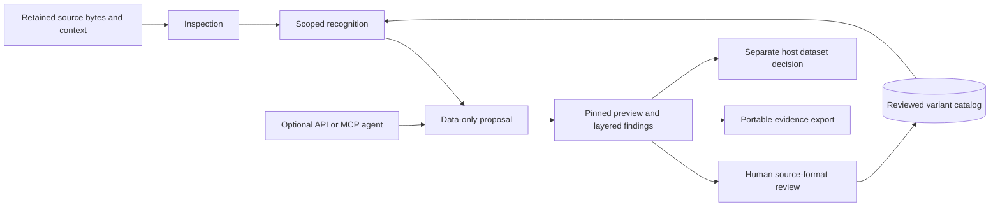

# Architecture

The reusable boundary is source interpretation and reviewed adaptation. Acquisition,
operational datasets, identity decisions and acceptance remain the caller's responsibility.

## Modules

| Boundary | Modules | Ownership |
|---|---|---|
| Source readers | `adapters/csv_roster`, `adapters/native` | Bounded bytes, source locators, retained unknowns |
| Interpretation | `engine`, `recipes`, `contracts`, `models` | Stateless execution, canonical meanings, findings and eligibility |
| Reuse | `recognition`, `catalog_store` | Scoped candidates, immutable definitions, transactional reviews |
| Assistance | `assistance`, `invocations`, `mcp_server` | Explicit external processing, bounded output, durable receipts, proposal-only agent writes |
| Portability | `exports`, `validation` | Hash-bound bundles and caller-attributed validator evidence |
| Consumers | `cli`, `workbench`, examples | Thin integrations over the shared engine |

## Decisions

Python provides straightforward embedding in analytical workflows. Standard-library CSV,
JSON and SQLite keep the base installation small. Native extensions can be reconsidered
if measured workloads exceed the declared budgets; they are unnecessary for current tests.

A variant is canonical JSON with a content-derived ID. It records headers, field roles,
allowlisted transforms, explicit boolean/date interpretations, local required fields,
conditional requirements, ignored fields and supporting evidence. It contains no executable
code. Definitions are validated once per execution, then prepared for row processing.

CSV records are iterated after decoding bounded input bytes. The original bytes and decoded
text are in memory; this is not constant-memory file ingestion. Preview details and finding
samples are capped independently of aggregate counts and blockers. Full CSV lineage uses a
second bounded assessment/pass and streams JSONL rather than retaining every output row.
Native FHIR reference indexes are built once within a bounded in-memory graph.

Catalog snapshots contain at most 1,000 active variants. Recognition assesses the whole
bounded scope before returning at most five candidates, so clipping cannot conceal ambiguity.
Sender/payer/network isolation and declared guide-version changes prevent silent semantic
inheritance. Reviewed source notes remain available after restart and export.

SQLite review uses `BEGIN IMMEDIATE` and an expected global catalog revision. Proposals
use content-idempotent request IDs. Reviews, variants and observations are append-only;
corrections create explicit supersessions. Existing pinned interpretations remain readable.
The optional Workbench bridge locks the host attempt before catalog mutation, always in
host-then-catalog order. No host operational records are written by format review.

The invocation journal is separate from the catalog. Atomic claims prevent duplicate local
publication. Running/unknown external outcomes are never retried automatically; cancellation
fences late responses. Received invalid/refused output is retained as evidence, not promoted.
This does not promise exactly-once execution at a remote model provider.

Bundle hashes detect corruption; they do not authenticate a sender. A manifest written last
marks export completion. Interrupted output is retained without a completion manifest.
Imported definitions require current-input checks and local review before trusted reuse.
